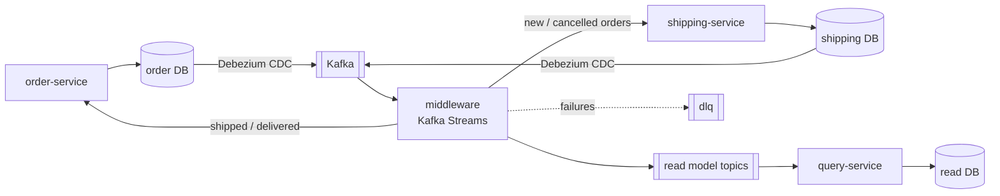

# cdc-modernization-demo

[](https://github.com/malekinasim/cdc-modernization-demo/actions/workflows/ci.yml)

**CQRS with a read side fed by Change Data Capture, and two-way sync between two services without loops.**

An order service writes to its own normalized database and knows nothing about Kafka. Debezium captures every
row change, and a Kafka Streams middleware does two things with it:

- builds a **read model** with a completely different shape (translated, joined, aggregated) for the queries;
- keeps a second system, the **shipping service**, in sync in both directions, without sending changes back
  where they came from.

The idea comes from a real modernization project I worked on, where CDC and Kafka kept a legacy system and new
services in sync. This demo rebuilds the core mechanisms on a small domain, every piece myself.

> **Status:** Sprint 1 (CDC pipeline end to end) is in progress. See the [milestones](https://github.com/malekinasim/cdc-modernization-demo/milestones).

## Architecture (draft)



Why each part exists, how the data models differ, and how loops are prevented:
[docs/domain-model.md](docs/domain-model.md).

## Modules

| Module | Role | Port |
|---|---|---|
| `order-service` | Command side: customers, products, orders, order lines. No Kafka code. | 8081 |
| `middleware` | Kafka Streams: translation, joins, aggregation, two-way sync with loop prevention, DLQ. | 8082 |
| `query-service` | Read side: denormalized read model in its own database, query API. | 8083 |
| `shipping-service` | A second system with its own model: shipments, carriers, tracking. | 8084 |

## Tech stack

Java 21 · Spring Boot 3 · PostgreSQL · Kafka (KRaft) · Kafka Connect + Debezium · Schema Registry + Avro ·
Kafka Streams · Micrometer · Prometheus · Grafana · Testcontainers · Docker Compose

## How to run

Requirements: JDK 21 and Maven 3.9+. Docker is needed from issue #2 onward.

```bash
# build and run all tests
mvn verify
```

The Docker Compose setup comes in issue #2. Run instructions for the full pipeline will be added as each sprint lands.

## Roadmap

| Sprint | Dates | Goal |
|---|---|---|
| 1 | 12 Nov - 25 Nov 2026 | A change in the order database shows up as a clean, typed event in Kafka |
| 2 | 26 Nov - 9 Dec 2026 | The read model is built and queryable: joins, aggregation, idempotency, DLQ, replay |
| 3 | 10 Dec - 23 Dec 2026 | Shipping service and two-way sync without loops, observability, tests, demo |
