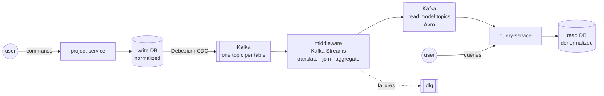

# cdc-modernization-demo

[](https://github.com/malekinasim/cdc-modernization-demo/actions/workflows/ci.yml)

**CQRS where the read side is kept up to date with Change Data Capture.**

An application writes to its own normalized database and knows nothing about Kafka.
Debezium captures every row change, and a Kafka Streams middleware turns those row changes into a read model
with a completely different shape: translated, joined and aggregated, one row per screen.

The idea comes from a real modernization project I worked on, where CDC and Kafka kept a legacy system
and new services in sync. This demo isolates the core mechanism and builds every piece, from the
Debezium connector to the Grafana dashboard.

> **Status:** Sprint 1 (CDC pipeline end to end) is in progress. See the [milestones](https://github.com/malekinasim/cdc-modernization-demo/milestones).

## Architecture (draft)



Why each part exists, and how the two data models differ, is described in [docs/domain-model.md](docs/domain-model.md).

## Modules

| Module | Role | Port |
|---|---|---|
| `project-service` | Command side: projects, tasks, plans and monthly progress in a normalized model. No Kafka code. | 8081 |
| `middleware` | Kafka Streams: translates CDC row changes and builds the read model with joins and aggregation. | 8082 |
| `query-service` | Read side: stores the read model in its own database and serves queries. | 8083 |

## Tech stack

Java 21 · Spring Boot 3 · PostgreSQL · Kafka (KRaft) · Kafka Connect + Debezium · Schema Registry + Avro ·
Kafka Streams · Micrometer · Prometheus · Grafana · Testcontainers · Docker Compose

## How to run

Requirements: JDK 21 and Maven 3.9+. Docker is needed from issue #2 onward.

```bash
# build and run all tests
mvn verify
```

The Docker Compose setup (Kafka, Schema Registry, Kafka Connect with Debezium, write and read PostgreSQL databases,
Kafka UI) comes in issue #2. Run instructions for the full pipeline will be added as each sprint lands.

## Roadmap

| Sprint | Dates | Goal |
|---|---|---|
| 1 | 12 Nov - 25 Nov 2026 | A change in the write database shows up as a clean, typed event in Kafka |
| 2 | 26 Nov - 9 Dec 2026 | The read model is built and queryable: joins, aggregation, idempotency, DLQ, replay |
| 3 | 10 Dec - 23 Dec 2026 | More read models, observability, integration tests and a demo ready for interviews |
