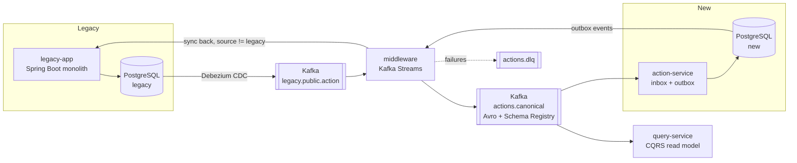

# cdc-modernization-demo

[](https://github.com/malekinasim/cdc-modernization-demo/actions/workflows/ci.yml)

Legacy system modernization with **Change Data Capture (Debezium)**, **Kafka**, **Kafka Streams** and **CQRS**.

A legacy monolith and a new service run side by side during a *Strangler Fig* migration.
Every change on one side reaches the other side through Kafka. The design has to handle
duplicate events and must never send an event back to the system it came from.

This is a small, runnable version of a real modernization project I worked on.
In that project another team built the CDC part; here I build every piece myself,
from the Debezium connector to the Grafana dashboard.

> **Status:** Sprint 1 (CDC pipeline end to end) is in progress. See the [milestones](https://github.com/malekinasim/cdc-modernization-demo/milestones).

## Architecture (draft)



Key ideas:

- **CDC instead of dual writes.** The legacy app is not changed to publish events. Debezium reads its database log.
- **Canonical events.** The middleware turns database-shaped CDC records into a typed `ActionChanged` Avro event.
- **Loop prevention.** Every event carries a `source` header. The middleware never routes an event back to its source.
- **Idempotency.** The new service records processed event IDs in an inbox table, so redelivered events are skipped.
- **CQRS.** Writes go to the services. Reads come from a separate, denormalized read model.

## Modules

| Module | Role | Port |
|---|---|---|
| `legacy-app` | The legacy monolith. Deliberately old-style: one service class, direct JPA, no events. | 8081 |
| `middleware` | Kafka Streams: unwraps Debezium envelopes, maps to canonical Avro events, routes by source, DLQ. | 8082 |
| `action-service` | The new service: own database, inbox table for idempotency, outbox for its own changes. | 8083 |
| `query-service` | CQRS read side: a denormalized read model and a query API. | 8084 |

## Tech stack

Java 21 · Spring Boot 3 · PostgreSQL · Kafka (KRaft) · Kafka Connect + Debezium · Schema Registry + Avro ·
Kafka Streams · Micrometer · Prometheus · Grafana · Testcontainers · Docker Compose

## How to run

Requirements: JDK 21 and Maven 3.9+. Docker is needed from Sprint 1 issue #2 onward.

```bash
# build and run all tests
mvn verify
```

The Docker Compose setup (Kafka, Schema Registry, Kafka Connect with Debezium, two PostgreSQL databases, Kafka UI)
comes in issue #2. Run instructions for the full pipeline will be added here as each sprint lands.

## Roadmap

| Sprint | Dates | Goal |
|---|---|---|
| 1 | 12 Nov - 25 Nov 2026 | A change in the legacy database shows up as a clean, typed event in Kafka |
| 2 | 26 Nov - 9 Dec 2026 | Legacy and new service run side by side, without loops or duplicates |
| 3 | 10 Dec - 23 Dec 2026 | CQRS read model, Grafana observability and a demo ready for interviews |
